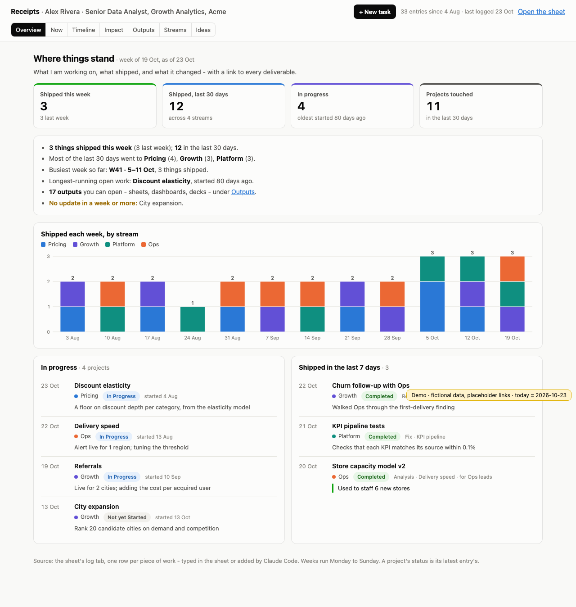
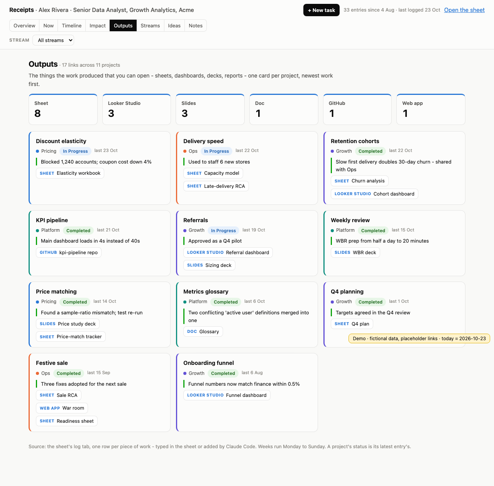
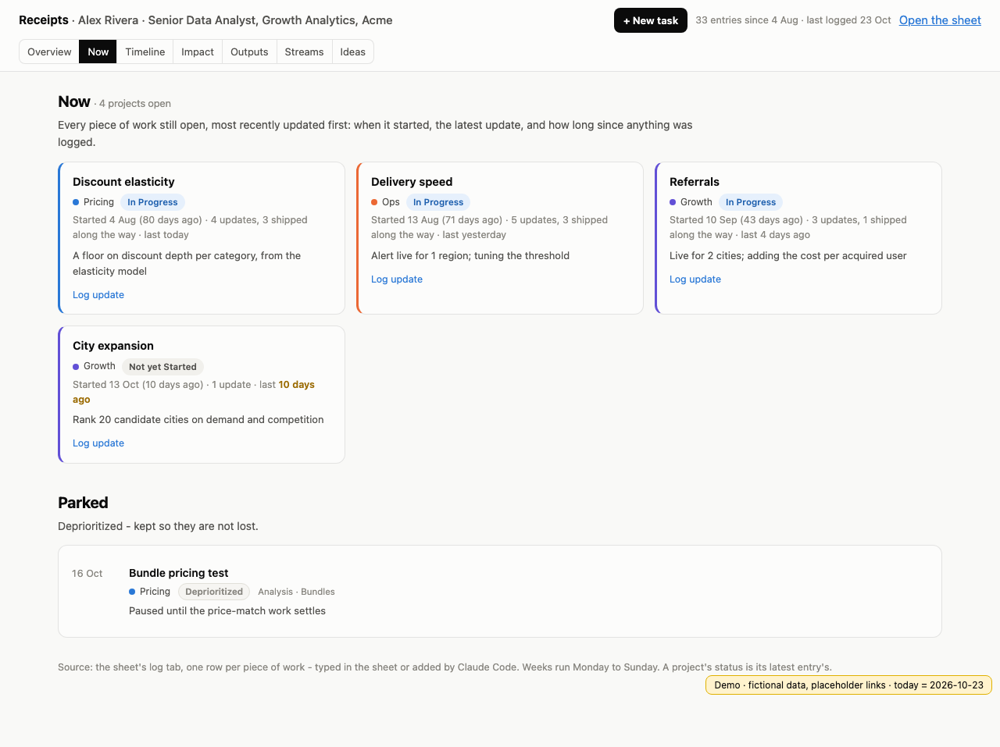
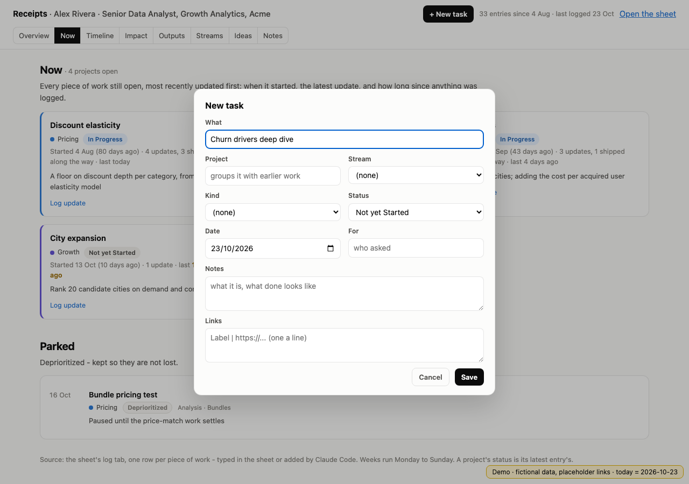
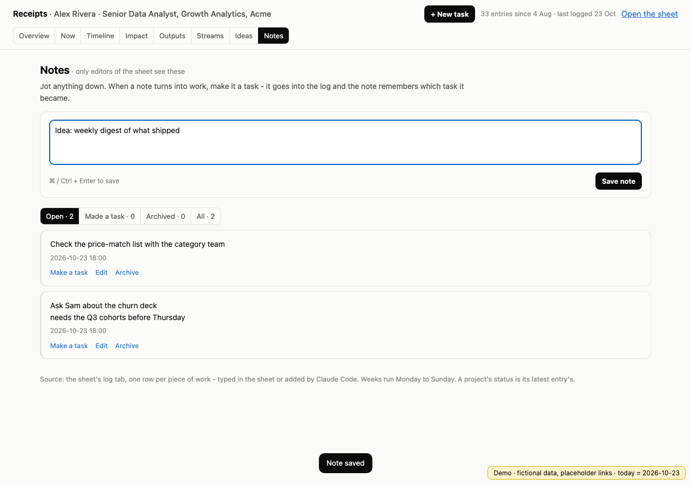

# Receipts

**Show the receipts for your work.**

One link that shows what you're working on, what you shipped, and what it changed - with a link to every sheet, dashboard,
deck, PR and app behind it. Claude Code keeps it up to date for you.

**[Live demo →](https://l69d.github.io/receipts/)** (a fictional analyst, placeholder links)



When your manager asks what you did this quarter, when review season comes round, when a new lead joins and wants to know
what you own - you send one link instead of writing it all up again. Every claim comes with its receipt.

## What people see

| Tab | What it answers |
|---|---|
| **Overview** | Shipped this week and in the last 30 days, what's in progress, a week-by-week chart by stream, and plain-language lines on where the time went |
| **Now** | Every open piece of work: when it started, the latest update, and a flag when nothing has moved in a week |
| **Timeline** | Every entry, newest first, by week - filter by stream and status, search everything |
| **Impact** | What the work changed, entry by entry, and how much of each kind of work shipped |
| **Outputs** | The receipts: every project's sheets, dashboards, decks, PRs and apps, one card each |
| **Streams** | The areas your work falls into, with what shipped in each |
| **Ideas** | What's worth doing next |

| Outputs | Now |
|---|---|
|  |  |

It works on a phone, it's light-only and quick to read, and viewers need only the link - never the sheet.

## How it works

```
  you, in the sheet ──────────┐
                              ▼
  Claude Code ──► Inbox.gs ──► npm run release ──► Google Sheet (log tab) ──► the web app ──► anyone with the link
  "update my receipts"         (tests gate it)       your data, your account    runs as you
```

- **The Google Sheet is the source.** One row per piece of work: date, item, project, stream, kind, status, notes,
  impact, link, for. Type rows yourself whenever you like.
- **Claude Code fills it for you.** Say *"update my receipts"*. The bundled skill finds what you did since the last entry -
  your commits, merged PRs, Claude Code memory and notes, and the documents and dashboards you opened - writes the entries
  with a link to each deliverable, runs the tests, and releases. Each entry lands in the sheet exactly once, on the next
  open of the page. No sheet credentials, no service account.
- **The web app** is an Apps Script page bound to the sheet. It runs as you, so viewers see the page but not the sheet.

## Quickstart

You need: a Google account, Node 18+, Python 3 with pandas (for the tests), and [Claude Code](https://claude.com/claude-code).

1. **Make your copy private.** Click **Use this template → Create a new repository → Private**, then clone it. Your
   log will live in it, so do not make it public.
2. **Set it up** - a new Google Sheet, the app bound to it, deployed on a link that never changes:
   ```bash
   npx clasp login          # once: sign in to Google
   npm run setup            # Google Workspace account (open to your organisation)
   ACCESS=ANYONE npm run setup   # or: a personal Google account
   ```
3. **Open the link once and approve.** The first open sets up the sheet's tabs.
4. **Fill the `config` tab** - your name, title, team, and a one-line tagline.
5. **Log your work.** In Claude Code, in this folder: *"update my receipts"* (or `/receipts`).

To use the skill from any folder, link it into your user skills:
`ln -s "$PWD/.claude/skills/receipts" ~/.claude/skills/receipts`.

## Logging tasks from the page

When someone hands you work, press **+ New task** - what, project (your existing ones are suggested), stream, kind,
status, date, who asked, notes, links - and it's in the sheet. On the **Now** tab every open piece of work has
**Log update**: the same form, filled in for that project, to record progress or mark it done.

Only the sheet's editors see the button, and the server checks again on every save.

Saving is instant: the task or note is on the page the moment you save, and the server confirms in the background. If a
save fails, nothing is lost - your words go back into the box (or the task form comes back as you left it). A save
touches only what it changes: a few spreadsheet calls and a reply of a few dozen characters, held to a budget by
`tests/test_speed.js`.



## Notes

A notepad for the sheet's editors: jot things down as they come up (⌘ / Ctrl + Enter saves), edit, archive. When a note
turns into work, **Make a task** opens the task form with the note's first line as the task and the rest as its notes -
saving adds the task and marks the note with the task it became. Notes live in the sheet's `notes` tab; viewers are
never sent them.



## Logging by hand

Or add a row to the `log` tab yourself. Dates as `2026-10-22` (or day first, `22/10/2026`); status `Completed`, `In Progress`,
`Not yet Started` or `Deprioritized` (`done` and `wip` work too). Entries with the same **project** form a thread, and a
thread's status is its latest entry's - that is what the Now tab shows.

The **link** column takes several links, one per line, as `Label | url`. Each shows as a chip that says what it is
(Sheet, Slides, Doc, Web app, Looker Studio, GitHub, ...).

**Links are receipts:** put in your own deliverables - what someone would open to see your work. Not inputs, other teams'
reports, or working copies. The skill follows the same rule and asks you when it isn't sure a document is yours.

## Privacy

- Your data stays in your Google account (the sheet) and in your private copy of this repo (`Inbox.gs`).
- The page runs as you. Viewers see the page, not the sheet; only the sheet's editors get the "Open the sheet" link.
- `tools/recent_outputs.py` reads Chrome's history **on your machine** and prints only work documents (Google Sheets,
  Slides, Docs, deployed web apps, Looker Studio, RowZero, Drive folders). Every other URL is dropped before anything is
  printed. Nothing is stored or sent anywhere.
- The skill refuses to write your log into a public repo.

## Development

```bash
npm test                       # rebuilds the demo preview, runs every suite
npm run preview                # the app offline on the demo data (tests/preview.html)
npm run release -- "v1.1 - what changed"   # tests, push, new version on the same link
```

The suites hold the app to an independent calculation (pandas, in `tests/build_preview.py`) and drive the real page in a
browser:

- **wiring** - every element and server call the page uses exists
- **server** - `Code.gs` on a fake spreadsheet: first-time setup, columns by name, dates and statuses typed by hand, the
  inbox and link rules, editors-only sheet link
- **model** - every number on the page against pandas
- **ui** - Playwright: every tab and filter, no `NaN` / `undefined`, light in a dark-mode browser, no sideways scroll on a phone

Every change ships with its checks; `npm run push` and `npm run release` refuse to ship when a suite fails.

## FAQ

**Does my organisation need anything special?** No - it's a Google Sheet and an Apps Script web app in your own account.
With a Google Workspace account the page is open to your organisation; with a personal account, to anyone with the link
(`ACCESS=ANYONE`).

**Can I edit the sheet directly?** Yes - it's yours. Reorder columns, add your own; the app reads columns by name.
Claude Code never overwrites a link you typed.

**Does it need Chrome?** Only for picking up links from your browsing. Commits, PRs and notes work without it.
`--chrome-dir` points it at Chromium, Brave or Edge.

## License

MIT
